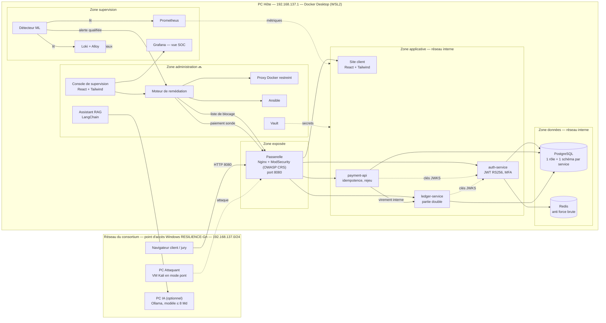

# RESILIENCE-ALPHA — Dossier d'architecture

> Version 0.1 — 19/10/2026 — pour validation coach (sprint 1)
> Auteur : Karim Boudali — Consortium G‹n›
> Légende : ✅ en place et testé · 🔜 prévu dans la semaine

## 1. Objectif

Démontrer qu'une plateforme de paiement fictive peut **subir une attaque, la détecter par apprentissage automatique et se rétablir sans intervention humaine**. La preuve de reprise est un **nouveau paiement réussi** avec un grand livre cohérent, pas un simple redémarrage de conteneur.

## 2. Schéma d'ensemble

## 3. Rôle de chaque composant

| Composant | Rôle | Techno | État |
|---|---|---|---|
| Passerelle | Seul point d'entrée exposé. Pare-feu applicatif (OWASP CRS, 856 règles), limites de débit par IP, liste de blocage, routage, en-têtes de sécurité | Nginx + ModSecurity | ✅ |
| Site client | Connexion, soldes, paiement, historique | React + Tailwind | ✅ |
| auth-service | Authentification, jetons JWT signés RS256 (15 min), MFA TOTP pour opérateurs et admins, verrouillage après échecs | Python / FastAPI | ✅ |
| payment-api | Création et suivi des paiements, clé d'idempotence obligatoire, rejeu automatique des paiements en attente | Python / FastAPI | ✅ |
| ledger-service | Comptes et soldes, grand livre en partie double, contrôle d'intégrité toutes les 30 s | Python / FastAPI | ✅ |
| PostgreSQL | Données métier ; un rôle et un schéma par service, délai maximal par requête de 5 s | PostgreSQL 16 | ✅ |
| Redis | Compteurs d'échecs de connexion | Redis 7 | ✅ |
| Prometheus | Collecte des métriques toutes les 15 s (requêtes, latence, erreurs, métier) et 12 règles d'alerte (disponibilité, intégrité, sécurité) | Prometheus 3.5 | ✅ |
| Collecteurs | Métriques de la passerelle, de PostgreSQL (compte en lecture seule `monitor_svc`) et de Redis | nginx-, postgres-, redis-exporter | ✅ |
| Loki + Alloy | Centralisation des journaux de tous les conteneurs. Alloy en déduit aussi des compteurs (requêtes par statut, blocages du WAF) pour Prometheus | Loki 3.5, Grafana Alloy | ✅ |
| Proxy Docker en lecture seule | Seul accès d'Alloy à Docker : lister les conteneurs et lire leurs journaux, aucune action possible | docker-socket-proxy | ✅ |
| Grafana | Tableaux de bord « Vue d'ensemble » et « Vue SOC » (WAF, limitation de débit, connexions, IP sources, alertes), provisionnés depuis le dépôt | Grafana 12 | ✅ |
| Détecteur ML | Détection d'anomalies sur métriques et journaux ; classe le type d'incident | Python, scikit-learn | 🔜 |
| Moteur de remédiation | Reçoit l'incident, choisit et exécute le playbook, vérifie la reprise par un paiement sonde | Python / FastAPI | 🔜 |
| Proxy Docker restreint | Seul accès du moteur à Docker, limité à inspecter et redémarrer | docker-socket-proxy | 🔜 |
| Ansible | Déploiement reproductible et playbooks de remédiation | Ansible (en conteneur) | 🔜 |
| Vault | Coffre-fort des secrets, rotation | HashiCorp Vault | 🔜 |
| Console de supervision | Pour le jury : état des services, alertes, avancement de la reprise | React + Tailwind | 🔜 |
| Assistant RAG | Aide l'opérateur à partir des procédures et de ce dossier. Lecture seule, aucun droit sur le système | Ollama + LangChain | 🔜 |

## 4. Interfaces

**Exposées par la passerelle (port 8080)** — toute autre route `/api/*` renvoie 404 :

| Route | Service | Accès |
|---|---|---|
| `POST /api/auth/login` | auth-service | public, limité à 5 req/s par IP |
| `GET /api/auth/me` | auth-service | jeton JWT |
| `GET /api/accounts/me`, `/api/accounts/beneficiaries` | ledger-service | jeton client |
| `POST /api/payments` (en-tête `Idempotency-Key`), `GET /api/payments` | payment-api | jeton client |
| `/` | site client | public |

**Internes uniquement** (jamais routées par la passerelle) :

| Appel | Protection |
|---|---|
| payment-api → `POST ledger-service/internal/transfers` | jeton interne partagé |
| moteur → `GET ledger-service/internal/integrity`, `POST payment-api/internal/reconcile` | jeton interne partagé |
| services → `GET auth-service/.well-known/jwks.json` | réseau interne |
| Prometheus → `/metrics` de chaque service | réseau interne |

## 5. Chaîne de résilience (cible)

| Étape | Mécanisme | Composant |
|---|---|---|
| 1. Collecte | Métriques (débit, latence, erreurs 4xx/5xx, paiements) et journaux JSON (passerelle, WAF, services) | Prometheus, Loki |
| 2. Détection | Modèle d'anomalies entraîné sur un comportement normal, plus une classification du type d'incident | Détecteur ML |
| 3. Décision | Choix du playbook selon le type d'incident (disponibilité ≠ compromission) | Moteur de remédiation |
| 4. Action | Bannir l'IP, durcir les limites, redémarrer, révoquer les sessions, renouveler les secrets | Moteur → passerelle, proxy Docker, Ansible, Vault |
| 5. Vérification | Service prêt, paiement sonde réussi, grand livre cohérent, paiements en attente rejoués | Moteur → API, contrôle d'intégrité |

Déjà démontré : un paiement bloqué par une panne du grand livre reste « en attente », puis il est **finalisé automatiquement** après le retour du service, sans double débit.

## 6. Réseau et exposition

- **PC Hôte** : il porte le point d'accès Wi-Fi (`192.168.137.1`). **Seule la passerelle** est publiée sur ce réseau (port 8080).
- **Grafana et la console de supervision** : publiées uniquement sur `127.0.0.1`, donc consultables sur le PC Hôte seulement. **Base de données, Redis, Vault et API internes** : jamais publiés.
- **Docker** : trois réseaux séparés. Les réseaux « applicatif » et « données » sont internes, sans sortie Internet. La base n'est joignable que par les services métier.
- **Conteneurs durcis** : utilisateur non root, système de fichiers en lecture seule, aucune capacité Linux, `no-new-privileges`, limites de mémoire, de CPU et de processus.
- **PC Attaquant** : uniquement connecté au point d'accès du groupe, sans aucun composant défensif.

## 7. Choix techniques et arbitrages

| Choix | Raison |
|---|---|
| Python/FastAPI pour tous les services | Une seule stack à maîtriser et à défendre devant le jury, et la même que le ML et le RAG |
| Grand livre en partie double + idempotence | Rend la reprise vérifiable : pas de double débit, et une incohérence est détectée automatiquement |
| Redis en mode dégradé ouvert (fail-open) | Si Redis tombe, la connexion reste possible, et l'événement est journalisé. On privilégie la disponibilité du paiement |
| Jetons courts (15 min) vérifiés par JWKS | Un renouvellement de clé invalide immédiatement toutes les sessions (remédiation après vol d'identifiants) |
| Secrets en fichiers | Docker secrets aujourd'hui, Vault ensuite, sans modifier le code des services |
| Pas d'Elastic | Imposé par le sujet (mémoire du PC Hôte) : Loki à la place |

## 8. Points ouverts

1. **IP source réelle** : sous Windows, Docker Desktop peut masquer l'adresse de l'attaquant. À tester depuis Kali dès le sprint 2. Si c'est confirmé, le blocage s'appuiera sur d'autres critères que l'IP seule.
2. **Mémoire** : Docker dispose de 8 Go. Avec la supervision, la plateforme utilise environ 700 Mo : la limite est conservée et sera revue seulement si nécessaire.
3. **Modèle de langage** : 8 Md de paramètres sur le PC IA s'il est disponible, sinon un modèle d'environ 3 Md sur le PC Hôte.
