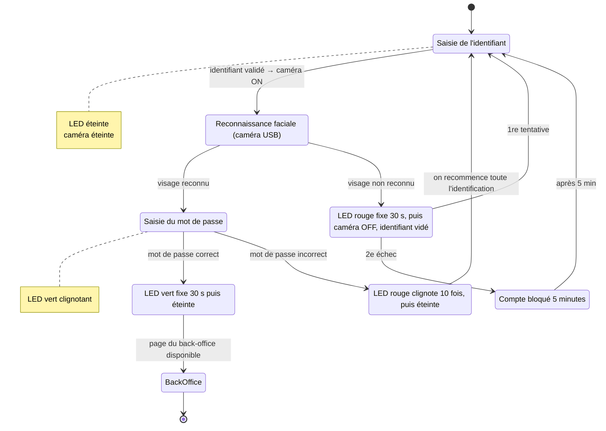
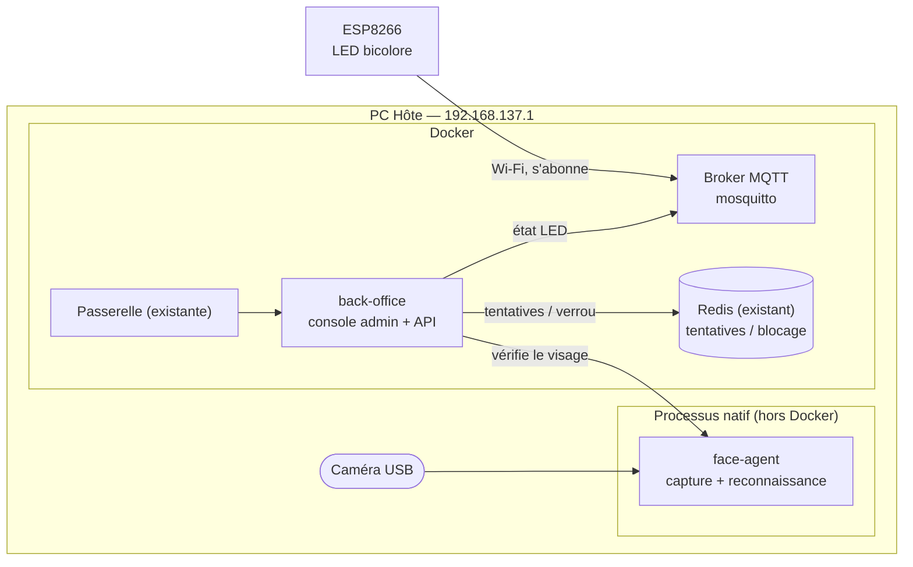

# RESILIENCE-ALPHA — Consigne additionnelle 1

> Version 0.1 — 20/10/2026 — pour validation coach
> Auteur : Karim Boudali — Consortium G‹n›
> Légende : ✅ en place et testé · 🔜 à construire
> Se rattache au dossier principal `architecture.md` (zone administration, marquée 🔜).

## 1. Demande

Renforcer l'authentification du **back-office** (console d'administration), suite à des remontées
d'attaques physiques et informatiques. Deux ajouts :

1. **Reconnaissance faciale** à la connexion : après l'identifiant, une caméra USB confirme le
   visage avant d'autoriser la saisie du mot de passe.
2. **Indicateur physique** : un objet connecté ESP8266 avec une LED bicolore (rouge/vert) montre
   l'état de la connexion en temps réel, via le Wi-Fi.

Contraintes imposées par le sujet :

- La caméra USB est **obligatoirement** branchée sur le **PC Hôte**.
- L'IA de reconnaissance de visage est **légère** et tourne sur le **PC Hôte**.
- La reconnaissance et les habilitations sont **gérées depuis le back-office**.
- Le firmware de l'ESP8266 est développé sous **JetBrains CLion + PlatformIO**.
- L'ESP8266 est connecté en **Wi-Fi** au point d'accès `RESILIENCE-G‹n›`.

## 2. Déroulé attendu (machine à états)

Table des états de la LED :

| Moment | État LED |
|---|---|
| Au repos / caméra éteinte | éteinte |
| Visage reconnu, saisie du mot de passe en cours | **vert clignotant** |
| Mot de passe validé | **vert fixe 30 s** puis éteinte |
| Visage non reconnu | **rouge fixe 30 s** puis caméra éteinte |
| Mot de passe incorrect | **rouge clignote 10 fois** puis éteinte |

Règles de blocage (réutilisent le mécanisme Redis déjà en place pour l'anti force brute) :

- Visage non reconnu : **1 nouvelle tentative**, puis blocage **5 minutes**.
- Mot de passe incorrect : retour complet à la phase d'identification (identifiant vidé, caméra
  éteinte), sans révéler lequel des deux facteurs a échoué.

## 3. Composants à ajouter

| Composant | Rôle | Techno proposée | Où | État |
|---|---|---|---|---|
| back-office | Page de connexion (2 phases), machine à états, gestion des habilitations, enrôlement des visages, pilotage de la LED | React + Tailwind (front) / FastAPI (API) | Docker, derrière la passerelle | 🔜 |
| face-agent | Accède à la caméra USB, calcule l'empreinte du visage, compare à la base enrôlée, renvoie reconnu/non reconnu | Python natif sur le PC Hôte | Processus natif (pas conteneur) | 🔜 |
| Broker MQTT | Canal découplé entre le back-office et l'ESP8266 | Eclipse Mosquitto | Docker, publié sur le réseau du point d'accès | 🔜 |
| Firmware ESP8266 | Se connecte au Wi-Fi, s'abonne au canal LED, pilote la LED bicolore selon l'état reçu | C++ (framework Arduino), CLion + PlatformIO | Objet connecté | 🔜 |

### Pourquoi face-agent tourne en natif (pas en conteneur)

Sous Docker Desktop (WSL2 sur Windows), **passer une caméra USB à un conteneur n'est pas
fiable**. Le plus simple et robuste est donc un petit processus Python natif sur le PC Hôte, qui
possède la caméra et expose une API locale appelée par le back-office. C'est aussi cohérent avec
la consigne (« caméra sur le PC Hôte », « IA sur le PC Hôte »).

### Pourquoi un broker MQTT pour la LED

L'ESP8266 est sur le réseau Wi-Fi (`192.168.137.x`), le back-office est dans Docker. Un broker
MQTT découple les deux : le back-office **publie** un état (`off`, `green_blink`, `green_solid`,
`red_solid`, `red_blink`) sur un sujet, l'ESP8266 **s'abonne** et réagit. Pas besoin que le
back-office connaisse l'adresse IP de l'ESP, et l'ESP se reconnecte tout seul s'il redémarre.

## 4. Interfaces à ajouter

**Exposées par la passerelle (nouvelles routes du back-office)** :

| Route | Rôle | Accès |
|---|---|---|
| `GET /admin` | Page de connexion du back-office | public (derrière le WAF) |
| `POST /api/admin/login/identify` | Phase 1 : reçoit l'identifiant, déclenche la reconnaissance faciale | public, limité par IP |
| `POST /api/admin/login/password` | Phase 2 : vérifie le mot de passe (uniquement si le visage est reconnu) | session partielle |
| `GET/POST /api/admin/enroll` | Enrôlement d'un visage pour un compte admin/opérateur | jeton admin |

**Internes (jamais exposées par la passerelle)** :

| Appel | Protection |
|---|---|
| back-office → `POST face-agent/verify` (identifiant → reconnu ?) | jeton interne, réseau hôte local |
| back-office → broker MQTT `publish resilience/backoffice/led` | identifiant/mot de passe MQTT |
| ESP8266 → broker MQTT `subscribe resilience/backoffice/led` | identifiant/mot de passe MQTT |

Sujet MQTT et charges utiles (proposition) : sujet `resilience/backoffice/led`, valeur = un des
mots-clés d'état. L'ESP8266 publie aussi `resilience/backoffice/led/status` (en ligne/hors ligne)
pour que le back-office sache si l'indicateur répond.

## 5. Sécurité et points d'attention

- **Donnée biométrique** : on stocke une **empreinte** (vecteur) du visage, pas les photos
  brutes ; en local uniquement. À documenter dans l'analyse de risque (`ebios-rm.md`) comme
  donnée sensible, avec finalité, durée de conservation et suppression à la radiation d'un compte.
- **Pas de fuite d'information** : un échec (visage ou mot de passe) ne doit jamais dire lequel
  des deux a échoué, pour ne pas aider un attaquant.
- **La LED est un indicateur, pas une sécurité** : même si quelqu'un usurpe le canal MQTT, il ne
  gagne aucun accès. Le broker demande quand même un identifiant/mot de passe pour éviter le bruit.
- **Secrets de l'ESP8266** (SSID, clé Wi-Fi, identifiants MQTT) : jamais dans le dépôt. Ils
  passent par un fichier d'en-tête ou des `build_flags` PlatformIO, ignorés par Git.
- **Anti-rejeu / anti-déni** : réutiliser Redis pour le compteur de tentatives et le blocage
  5 minutes, comme pour l'authentification existante.
- **Front caméra** : la caméra est pilotée par le `face-agent` côté PC Hôte, pas par le navigateur,
  donc pas de dépendance au navigateur du jury ni de demande de permission `getUserMedia`.

## 6. Découpage du travail

Chaque lot est **testable seul**, ce qui est adapté au travail en solo : on valide une brique
avant de passer à la suivante.

| Lot | Contenu | Test de fin | Dépend de |
|---|---|---|---|
| **0. Décisions** | Choisir la bibliothèque de reconnaissance (p. ex. `face_recognition`/dlib, ou InsightFace), le câblage de la LED bicolore, confirmer MQTT | Décisions écrites dans ce document | — |
| **1. Firmware ESP8266** | Wi-Fi + client MQTT + pilotage LED (les 5 états). CLion + PlatformIO | La LED suit chaque état envoyé à la main via `mosquitto_pub` | Lot 0 |
| **2. Broker MQTT** | Conteneur Mosquitto, identifiants, intégration au réseau du point d'accès | L'ESP8266 se connecte et reçoit les messages | Lot 1 |
| **3. face-agent** | Capture caméra, enrôlement, reconnaissance, API locale `verify` | Reconnaît un visage enrôlé, rejette un inconnu, en ligne de commande | Lot 0 |
| **4. back-office** | Page de connexion 2 phases, machine à états, habilitations, blocage via Redis, publication de l'état LED | Parcours complet dans le navigateur, LED pilotée aux bons moments | Lots 2, 3 |
| **5. Intégration + démo** | Scénario de bout en bout, mise à jour de `architecture.md` et `ebios-rm.md`, scène de démo pour le jury | Démonstration complète rejouable | Lot 4 |

Ordre conseillé : **1 → 2 → 3 → 4 → 5**. Les lots 1-2 (matériel) et le lot 3 (reconnaissance)
sont indépendants et peuvent avancer en parallèle si besoin ; ils se rejoignent au lot 4.

## 7. Décisions à trancher (lot 0)

1. **Bibliothèque de reconnaissance** : `face_recognition` (dlib) est simple et « léger » au sens
   CPU ; InsightFace est plus précis mais plus lourd. À choisir selon la mémoire disponible sur le
   PC Hôte.
2. **Câblage de la LED bicolore** : deux broches GPIO (une par couleur) ou une LED à 3 pattes
   (anode/cathode commune). Décide les résistances et le schéma de câblage.
3. **Seuil de reconnaissance** : distance maximale acceptée entre l'empreinte vue et l'empreinte
   enrôlée (compromis entre faux positifs et faux négatifs). À régler pendant le lot 3.
4. **Lien face-agent ↔ back-office** : le back-office appelle le face-agent en HTTP sur le réseau
   hôte (`host.docker.internal`). À confirmer sous Docker Desktop.
